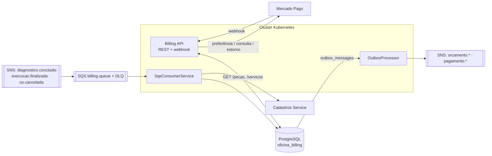

# Oficina — Billing Service (Orçamentos + Pagamentos)

Microsserviço da **Fase 4** (Tech Challenge) responsável por **orçamentos** e **pagamentos via Mercado Pago**.
Parte de um sistema de 3+ microsserviços (OS, Billing, Execução, Cadastros), cada um com repositório, banco e pipeline próprios.

| | |
|---|---|
| **Stack** | .NET 10, Clean Architecture, EF Core + PostgreSQL |
| **Banco** | PostgreSQL — database lógico `oficina_billing` (nenhum serviço acessa o banco de outro) |
| **Mensageria** | AWS SNS (tópicos) + SQS (fila `oficina-{env}-billing-queue` + DLQ) — [ADR 0005](docs/adrs/0005-sns-sqs-como-broker.md) |
| **Pagamento** | Mercado Pago Checkout Pro (sandbox) — [ADR 0006](docs/adrs/0006-outbox-e-mercado-pago-checkout-pro.md) |
| **Saga** | Orquestrado no OS Service — [ADR 0004](docs/adrs/0004-saga-orquestrado-vs-coreografado.md) |
| **Qualidade** | xUnit + Testcontainers + Reqnroll (BDD), cobertura ≥ 80 %, SonarCloud |
| **Deploy** | GitHub Actions → GHCR → Kubernetes (kustomize: `homolog` e `prod`) |
| **Observabilidade** | New Relic (agente .NET), logs JSON, `X-Correlation-Id` propagado em REST e eventos |

## Arquitetura



**Camadas:** `Domain` (agregados `Orcamento`, `Pagamento`, eventos) → `Application` (use cases, portas, handlers de mensagem) → `Infrastructure` (EF Core, SNS/SQS, SDK do Mercado Pago, REST clients) → `API` (controllers, middleware, composição).

### Fluxo completo de uma OS

1. `diagnostico.concluido` → busca preços no Cadastros → cria **Orçamento** (`Gerado`) + evento `orcamento.gerado`.
2. Cliente `POST /orcamentos/{id}/aprovar` → `orcamento.aprovado` (dispara a execução) — ou `/recusar` → `orcamento.recusado` (compensação).
3. `execucao.finalizada` → cria a **preferência** no Mercado Pago e o **Pagamento** (`Pendente`); `GET /pagamentos/{osId}` devolve o link.
4. Cliente paga no Mercado Pago → webhook → Billing **consulta o pagamento na API do MP**, confere o valor → `pagamento.confirmado` / `pagamento.recusado`.
5. `os.cancelada` (compensação) → cancela orçamento e cobrança pendente; **estorna** se já estava pago.

### Saga — estratégia e justificativa

**Orquestrado**, com o orquestrador no OS Service (dono do estado global da OS). Billing é *participante*: executa a etapa local, publica o desfecho e atende às compensações (`os.cancelada`). Justificativa completa, tabela de passos/compensações e alternativas descartadas em [ADR 0004](docs/adrs/0004-saga-orquestrado-vs-coreografado.md). Resumo: fluxo linear entre poucos serviços, ganho grande de rastreabilidade e depuração frente ao coreografado.

### Garantias de consistência

| Problema | Solução |
|---|---|
| Gravar no banco e publicar no SNS não é atômico | **Outbox Pattern** — evento gravado na mesma transação, publicado por `OutboxProcessor` (`FOR UPDATE SKIP LOCKED`) |
| SQS entrega *ao menos uma vez* | Handlers **idempotentes** (orçamento único por OS — índice único; estado do domínio) |
| Mercado Pago reenvia webhook | Estado do domínio + tabela `idempotency_keys` (`X-Idempotency-Key`/`x-request-id`) + concorrência otimista (`xmin`) |
| Webhook forjado | Assinatura `x-signature` (HMAC) **e** consulta autoritativa na API do MP **e** conferência do valor |
| Cobrança em duplicidade | Índice único parcial: 1 cobrança Pendente/Confirmada por OS |
| Mensagem que não processa | Não é apagada → retry → **DLQ** após 5 tentativas |

## API

Swagger UI em `/swagger` (`Swagger__Enabled=true`) · contrato em [`docs/openapi.yaml`](docs/openapi.yaml).

| Método | Rota | Descrição |
|---|---|---|
| GET | `/orcamentos/{osId}` | Orçamento da OS |
| POST | `/orcamentos/{orcamentoId}/aprovar` | Aprova (idempotente) → `orcamento.aprovado` |
| POST | `/orcamentos/{orcamentoId}/recusar` | Recusa (idempotente) → `orcamento.recusado` |
| GET | `/pagamentos/{osId}` | Pagamento da OS (com `linkPagamento`) |
| POST | `/pagamentos/webhook/mercado-pago` | Webhook do MP (idempotente, assinatura validada) |
| GET | `/health` · `/health/ready` | Liveness · readiness (banco) |

Eventos publicados/consumidos e formato do envelope: [`docs/events.md`](docs/events.md).

## Rodando localmente

```bash
cp .env.example .env              # MP fake por padrão: não precisa de credenciais
make up                           # API :5001 + PostgreSQL + WireMock (Cadastros/OS); eventos só logados
make up-aws                       # + LocalStack: outbox publica no SNS e o consumidor lê a fila de verdade
```

Com o **Mercado Pago fake** dá para simular um webhook sem rede: o `id` segue o formato `fake-{status}-{pagamentoId}`:

```bash
curl -X POST "localhost:5001/pagamentos/webhook/mercado-pago?data.id=fake-approved-<pagamentoId>&type=payment"
```

> O schema é criado/evoluído exclusivamente pelas migrations versionadas, aplicadas no startup quando `Database:MigrateOnStartup=true`. Não use `EnsureCreated` em ambientes persistentes.
>
> **Banco já existente de versões anteriores:** faça backup e compare o schema atual com `InitialBillingSchema` antes do deploy. Se ele já foi criado por `EnsureCreated`, a migration inicial precisa ser registrada como baseline após essa validação; não deixe o `Migrate()` tentar recriar tabelas existentes.

## Testando com o sandbox do Mercado Pago

1. Crie a conta em <https://www.mercadopago.com.br/developers> e uma **aplicação** (tipo *Checkout Pro*).
2. Em *Credenciais de teste*, copie o **Access Token de teste** → `MP_ACCESS_TOKEN` no `.env` (em homolog/prod: Secrets Manager `oficina/{env}/billing/mercadopago-access-token`).
3. Crie **usuários de teste** (*Contas de teste*): um **vendedor** (dono da aplicação) e um **comprador**. Use o comprador para pagar.
4. Exponha a API: `ngrok http 5001` → `MP_NOTIFICATION_URL=https://<id>.ngrok-free.app/pagamentos/webhook/mercado-pago`. (Em homolog: o ALB do `k8s/base/ingress.yaml`.)
5. Em *Webhooks*, cadastre a mesma URL (evento **Pagamentos**) e copie a **chave secreta** → `MP_WEBHOOK_SECRET` + `MP_VALIDATE_SIGNATURE=true`.
6. `MP_USE_FAKE=false`, `make up`, e dispare o fluxo (publique `diagnostico.concluido` → aprove → `execucao.finalizada`). Abra o `linkPagamento` e pague com um **cartão de teste**:

   | Bandeira | Número | CVV | Validade |
   |---|---|---|---|
   | Mastercard | 5031 4332 1540 6351 | 123 | 11/30 |
   | Visa | 4235 6477 2802 5682 | 123 | 11/30 |

   Titular **`APRO`** → aprovado · **`OTHE`** → recusado · **`CONT`** → pendente · CPF `12345678909`.
7. O webhook chega, o Billing consulta o MP, confirma e publica `pagamento.confirmado` (acompanhe nos logs, com o mesmo `X-Correlation-Id`).

## Testes e cobertura

| Suíte | Projeto | O que cobre |
|---|---|---|
| Unitários | `tests/OficinaBilling.UnitTests` | Domínio, todos os use cases (incl. webhook, compensação), assinatura, parser de mensagens, handlers |
| Integração | `tests/OficinaBilling.IntegrationTests` | API real + **PostgreSQL real** (Testcontainers): fluxo completo, idempotência, Saga, health |
| **BDD** | `tests/…/Features/Billing.feature` (Reqnroll, em português) | 7 cenários: diagnóstico→orçamento, aprovação→evento, recusa, webhook confirmado/recusado/duplicado, cancelamento (Saga) |

```bash
make test        # precisa de Docker (Testcontainers)
make coverage    # gera coverage-report/index.html e imprime o resumo
```

- **Passo a passo para testes manuais**, incluindo como publicar eventos via SNS no LocalStack, validar o fluxo completo, observar eventos publicados, testar o webhook fake/Sandbox e consultar a DLQ: [docs/testing-guide.md](docs/testing-guide.md).
- **Gate no CI:** o job `build-test-quality` falha se a cobertura de linhas ficar abaixo de **80 %** e aguarda o **Quality Gate do SonarCloud**.
- Ficam fora da cobertura apenas código gerado pelo OpenAPI, composição da aplicação, migrations e adapters que só rodam contra serviços reais (listados em `coverage.runsettings`).
- **Evidências:** o relatório HTML é publicado como artefato `coverage-report` em cada execução do CI.
  <!-- Após o primeiro CI verde, cole aqui: badge do SonarCloud + print do coverage-report + link da execução -->

## CI/CD (`.github/workflows`)

`ci.yml` → `build-test-quality` (build, testes, cobertura, Sonar) · `terraform-validate` · `docker-build` (push no GHCR com a tag do commit) → `deploy-homolog` → `deploy-prod` (aprovação manual via GitHub Environment).
`deploy.yml` (reutilizável): `terraform apply` (banco, topics, fila, IAM) → `kubectl apply -k k8s/overlays/{env}` → `rollout status` → smoke test em `/health/ready`.

**Variáveis do GitHub** (por Environment `homolog`/`prod`): `AWS_REGION`, `AWS_ACCOUNT_ID`, `EKS_CLUSTER`, `TF_STATE_BUCKET`, `OIDC_PROVIDER_ARN`, `OIDC_PROVIDER_URL`, `WEBHOOK_HOST`; **segredos:** `AWS_ROLE_ARN`, `RDS_ADMIN_USERNAME`, `RDS_ADMIN_PASSWORD`. Do repositório: `SONAR_TOKEN` (segredo), `SONAR_PROJECT_KEY` e `SONAR_ORGANIZATION` (variáveis).

**Branch `main` protegida** (PR obrigatório, 1 aprovação, checks verdes, sem push direto): `./scripts/protect-main.sh <owner>/<repo>`.

## Infraestrutura

- **Terraform** (`terraform/`): database lógico + role, topics próprios (`orcamento.*`, `pagamento.*`) com ARN no SSM, fila + DLQ, assinaturas nos 3 tópicos consumidos, secrets, **role IRSA** (nenhuma credencial AWS no pod).
- **Kubernetes** (`k8s/base` + `overlays/homolog|prod`): Deployment (probes, requests/limits), Service, HPA, Ingress ALB **só para o webhook**, ServiceAccount com IRSA.
- **New Relic:** agente na imagem, ativado no Deployment; crie o segredo da licença: `kubectl -n oficina-<env> create secret generic newrelic-license --from-literal=license-key=<KEY>`.

## Decisões em aberto / premissas

- Eventos consumidos e publicados seguem o envelope compartilhado (`eventType`/`data`, `osId`, `pecaId` e `servicoId`); aliases legados são aceitos pelo consumidor.
- Autenticação/autorização da API REST fica a cargo do gateway/ingress interno (como nas fases anteriores); o webhook é protegido por assinatura.
- Falha *permanente* na geração de orçamento vai à DLQ sem evento dedicado (ADR 0006, item 3).
